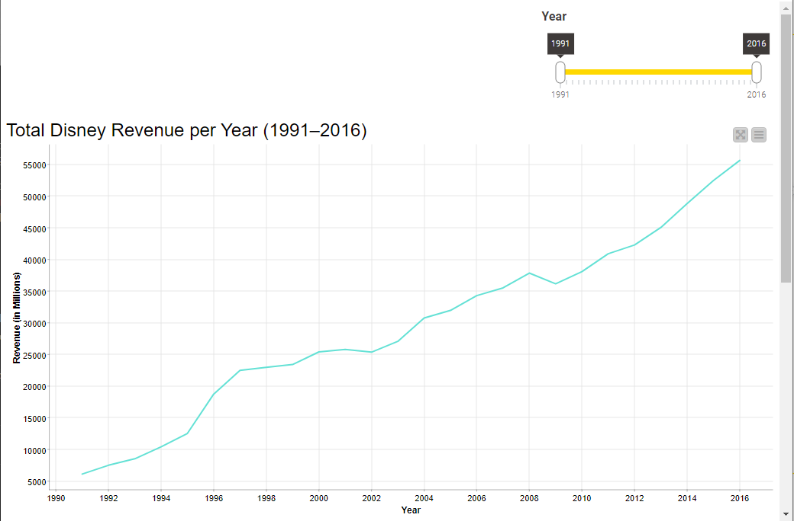
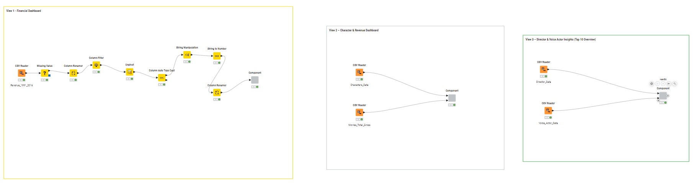
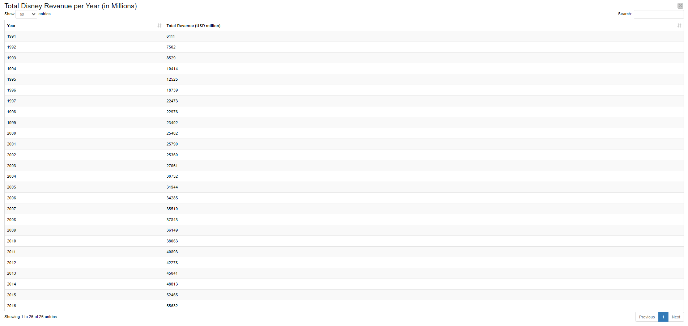
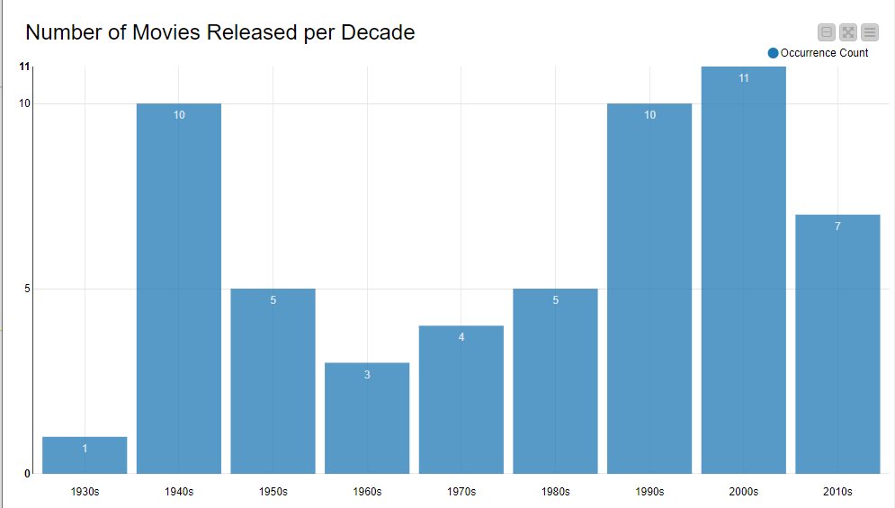
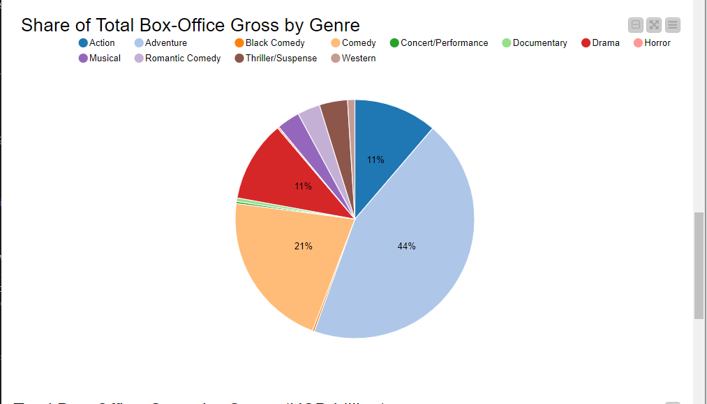
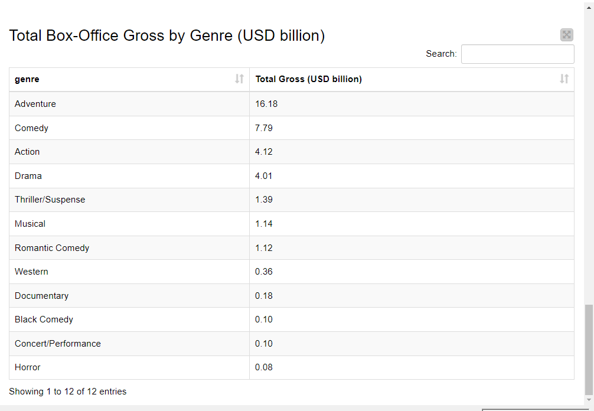
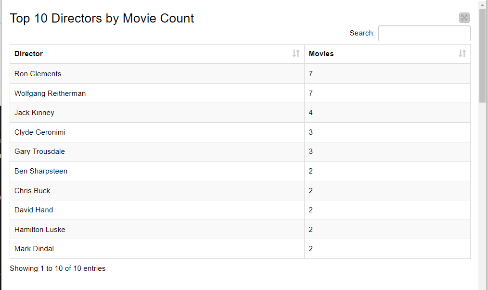
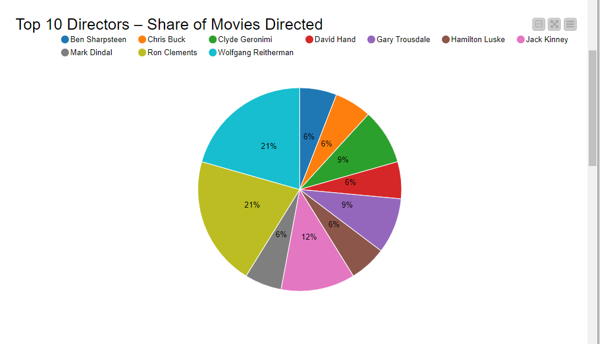
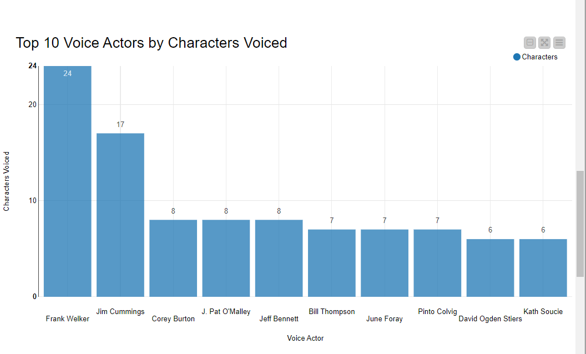

# Disney Data App: Interactive KNIME Dashboard

KNIME data app that integrates **five Disney datasets** and turns them into **three interactive dashboard views**: company revenue over time, movie releases and box-office gross by genre, and the most frequent directors and voice actors.

> **Context:** Study project, module *Analytics for Data Driven Decisions*, M.Sc. Management & IT, Westsächsische Hochschule Zwickau (WHZ), summer semester 2025. Reviewed and corrected in November 2026 (see [Review and corrections](#review-and-corrections)).



## Project at a glance

| | |
|---|---|
| Tool | KNIME Analytics Platform 5.5 (no code, visual workflow) |
| Data | 5 Disney CSV files (provided for the course): revenue 1991 to 2016, 579 movies with box-office gross, 56 animated movies with characters, directors, 935 voice-actor records |
| Output | Data app with 3 views, 2 to 4 charts or tables per view, interactive filters |
| Filters | Year range sliders (View 1 and View 2), genre and MPAA-rating filters (View 2) |

## Business questions

1. How did Disney's total revenue develop from 1991 to 2016?
2. In which decades were most animated Disney movies released?
3. Which genres generate the highest box-office gross?
4. Which directors and voice actors appear most often in Disney's animated films?

## Workflow



### Data preparation (in KNIME)

**Revenue data (top level)**
- CSV Reader with paths relative to the workflow data folder, so the workflow runs on any machine
- Missing Value: empty division values set to 0
- Column Renamer: short division names
- Unpivot: reported total revenue per year into a long table
- String Manipulation and String to Number: remove thousands separators and convert text to numbers

**View 2 component (movies and genres)**
- Release year taken from the release date, decade derived from the year (for example 1937 → 1930s)
- Box-office gross cleaned from text (`$184,925,485`) to numbers
- Rows without title or gross removed
- GroupBy: total gross per genre

**View 3 component (directors and voice actors)**
- Row Filter: placeholder value "full credits" removed from the director list, missing voice actors removed
- GroupBy: number of movies per director, number of characters per voice actor
- Sorter (descending) and Row Sampler (first 10 rows): real top 10 lists

## Dashboard views

### View 1: Total Disney revenue per year

Year range slider, line chart of the reported total revenue (USD millions) and a table with the yearly values.



### View 2: Movies and gross by genre

Release-year slider, bar chart of animated movie releases per decade, movie list, pie chart and table of box-office gross by genre. Genre and MPAA-rating filters let the user narrow the selection.





### View 3: Top directors and voice actors

Top 10 directors by number of movies (table and pie chart) and top 10 voice actors by number of characters voiced (bar chart and table).





More screenshots are in the [screenshots](screenshots/) folder.

## Selected observations

All figures are taken from the source data and describe it; they are not forecasts.

- **Revenue:** reported total revenue grew from **USD 6,111 million in 1991 to USD 55,632 million in 2016**, about 9 times higher.
- **Releases:** the 2000s have the most animated releases in the character dataset (**11**), followed by the 1940s and 1990s (**10** each).
- **Genres:** Adventure has the highest total box-office gross (about **USD 16.2 billion** for movies with genre and rating), clearly ahead of Comedy (about **USD 7.8 billion**). Gross is nominal, not inflation-adjusted.
- **People:** Wolfgang Reitherman and Ron Clements directed the most animated films (**7** each); Frank Welker voiced the most characters (**24**), followed by Jim Cummings (**17**).

## Review and corrections

In November 2026 I reviewed every node of the original exam workflow and corrected these points:

| Issue in the original | Correction |
|---|---|
| Yearly revenue was counted twice, because the "Total" column was unpivoted together with the division columns (1991 showed 12,222 instead of 6,111) | Only the reported total revenue is used for the yearly figures |
| Line chart zig-zagged because several values per year were drawn as one line | Chart now shows one value per year |
| "Top 10 Directors" used a random sample after sorting | Row Sampler set to the first 10 rows after sorting |
| "full credits" appeared as a director | Filtered out before counting |
| CSV readers used absolute paths on my laptop | Paths are now relative to the workflow data folder |
| Bar chart title said "per Year" although it shows decades | Title corrected to "per Decade" |
| Genre gross was shown as raw numbers (for example 16178462965) in alphabetical order | Converted to USD billion with 2 decimals and sorted from highest to lowest; pie chart shows percentage shares |
| Tables showed technical columns (RowID, selection boxes, names like `Sum(Revenue)` or `Movie_Count`) | Readable column names, technical columns hidden |

**Data notes:** the division columns in the revenue file are incomplete for some years (for example 1996 and 2016), so the yearly figures use the reported total. The genre view only counts movies with a genre and an MPAA rating (513 of 579).

## How to run

1. Install [KNIME Analytics Platform](https://www.knime.com/downloads) (version 5.5 or newer).
2. Download `workflow/Disney_DataApp.knwf`.
3. In KNIME: **File → Import KNIME Workflow** and select the file.
4. Open the workflow, execute all nodes (Shift+F7) and open the component views.

The CSV files are included in the workflow's data folder and also in [data](data/).

## Repository structure

```text
knime-disney-data-app/
├── README.md
├── workflow/
│   └── Disney_DataApp.knwf
├── data/
│   ├── disney_revenue_1991-2016.csv
│   ├── disney_movies_total_gross.csv
│   ├── disney-characters.csv
│   ├── disney-director.csv
│   └── disney-voice-actors.csv
└── screenshots/
```

## Skills shown

Data integration from several sources · data cleaning and type conversion · aggregation (GroupBy, Unpivot) · interactive dashboards with filter widgets · data storytelling · reviewing and correcting my own analysis

## Author

**Gazali Warsi** · M.Sc. Management & IT, WHZ Zwickau · [LinkedIn](https://www.linkedin.com/in/gazali-warsi) · More projects: [AutoScout24 Germany Marketplace Analytics](https://github.com/gazaliwarsi/autoscout24-germany-marketplace-analytics)
